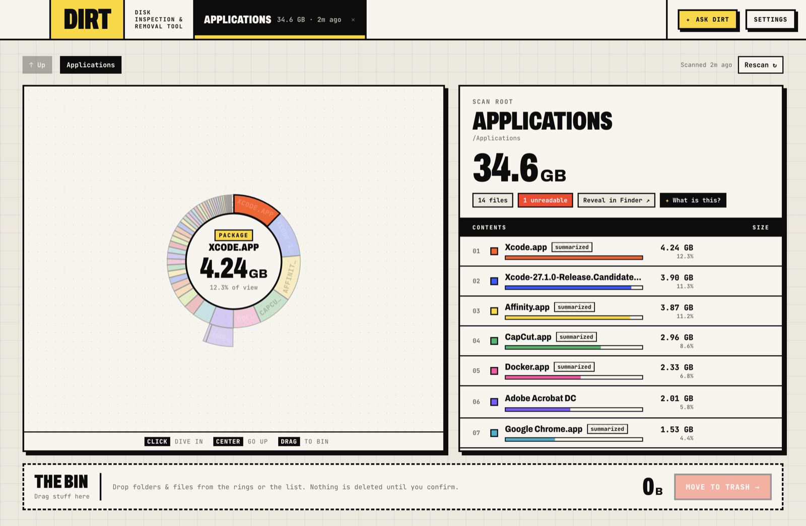
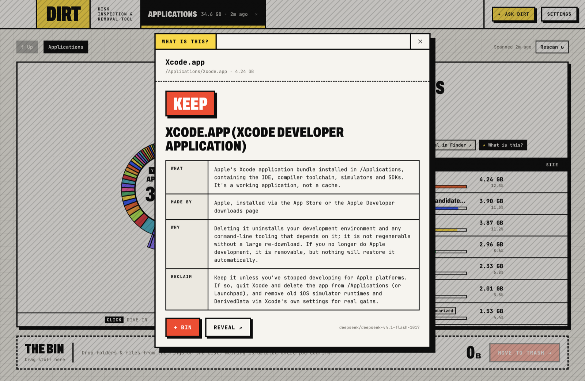
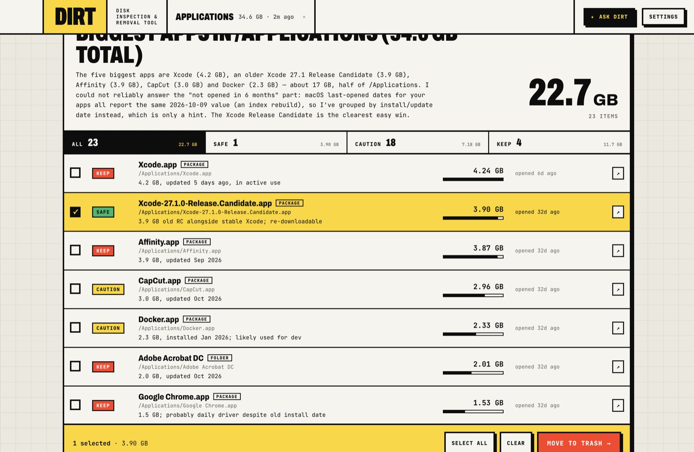
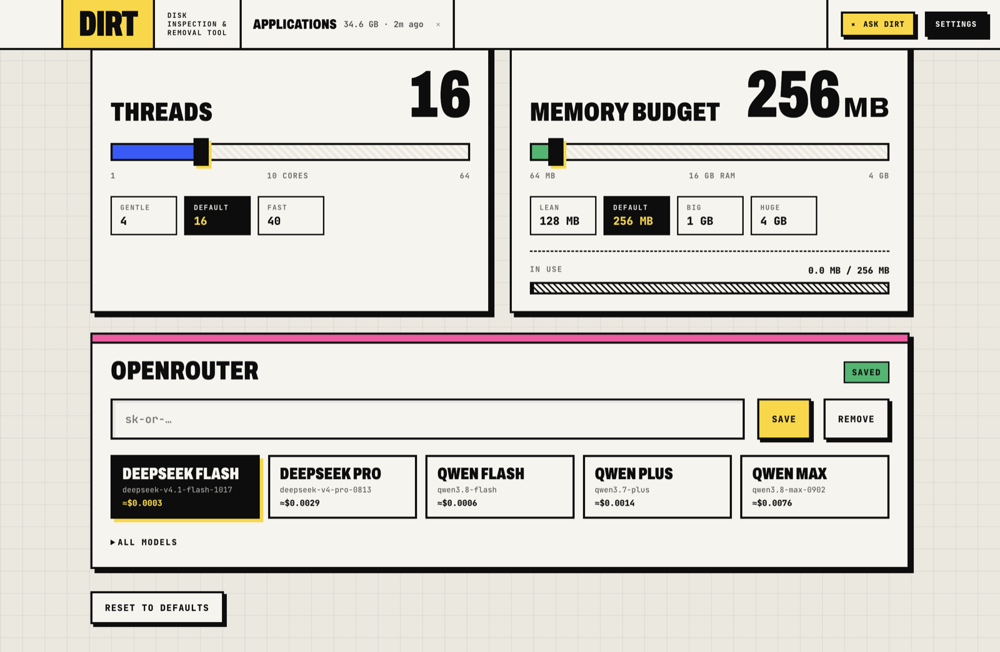

# DIRT

**Disk Inspection & Removal Tool.** A brutalist disk space visualizer for macOS, with an AI assistant that finds what you can safely clean up.


## What it does

### Drill into your disk
Scan a volume or folder and DIRT draws it as a zoomable sunburst. The middle ring is the top level, biggest first. Click any ring to dive in, click the center to go back up. Every scan is cached for a day, so finished results are still there after a restart.



- Several scans can run at once. They share one thread pool and memory budget, so the machine stays usable.
- `node_modules`, `.git`, caches, app bundles and iPhone backups are totaled as one block via native `du` instead of being walked file by file.
- Shift-click or ⌘-click rows to select in bulk, drag anything to **The Bin**, and move it to the Trash after a confirm. Nothing is deleted outright.

### ✦ What is this?
Right-click any ring or hit **✦ AI** on a row. DIRT tells you what the item is, what created it, whether it's safe to delete, and the right way to reclaim the space. It recognizes git repos and worktrees too.



### ✦ Ask DIRT
Ask in plain English: *"find old installers in Downloads"*, *"which worktrees can I delete?"*. The agent searches with metadata-only tools (names, sizes, dates, Spotlight info, git status) and returns a results page you can filter, bulk-select and send to the Trash.



**The AI never sees file contents.** See [Data & privacy](#data--privacy) for exactly what is sent.

### Git projects
Every repo DIRT finds, with each worktree's last use, size, dependencies and uncommitted/unpushed/merged status. You can diff a worktree against `main`, trash its `node_modules`/`target`, or remove it (changes are stashed first and the branch is kept). **Analyze ✦** has the AI sort a repo's ignored folders into build output you can regenerate versus data you can't.

### Settings
Threads and memory budget for scans, plus your OpenRouter key and model. Model families (DeepSeek, Qwen) always resolve to their newest version, and each one shows its cost per question.



## Install

1. Download `DIRT-<version>-universal.dmg` from Releases and drag DIRT to Applications.
2. Open it once. macOS will block it because it isn't notarized.
3. System Settings → Privacy & Security → **Open Anyway**.

DIRT can move files to the Trash and works best with Full Disk Access. If you'd rather not trust a prebuilt binary, [build it from source](#develop): `npm install && npm run dist` produces the same DMG.

For whole-disk scans, add DIRT under System Settings → Privacy & Security → **Full Disk Access**.

The AI features need an [OpenRouter](https://openrouter.ai) API key. Add it in Settings.

## Data & privacy

- **Scanning is local.** Nothing leaves your Mac unless you use an ✦ AI feature.
- **What the AI sees:** file and folder names, paths (your home folder shown as `~`), sizes, dates, Spotlight metadata (kind, last opened) and git status (branch, uncommitted/unpushed counts, merged or not). **Never file contents.**
- **Where it goes:** to [OpenRouter](https://openrouter.ai), and from there to the model you picked in Settings. Requests are tagged with the app name `DIRT`. Nothing is sent if no key is set.
- **Your API key** is stored in plain text at `~/Library/Application Support/DIRT/openrouter-key`, readable only by your user (permissions `0600`), the same way tools like `gh`, `npm` and the AWS CLI store tokens. It is not in the Keychain: unsigned builds change identity on every update, which made macOS ask for your login password after each install. Remove it any time from Settings.
- **Deleting:** DIRT only ever moves items to the Trash, after a confirm. Worktree removal stashes uncommitted changes first and keeps the branch.
- **No telemetry, no analytics, no accounts.**

## Develop

```sh
npm install
npm run dev     # Electron + Vite with live reload
npm run lint
npm run build   # type-check + bundle the UI
npm run dist    # universal .dmg in release/
npm run icon    # regenerate build/icon.icns
```

Regenerate the README screenshots (uses `/Applications` so nothing personal shows up):

```sh
npm run build && DIRT_SCREENSHOTS=docs OPENROUTER_API_KEY=… npx electron .
```

## Contributing

Issues and PRs welcome. See [CONTRIBUTING.md](CONTRIBUTING.md). To report a security problem privately, see [SECURITY.md](SECURITY.md).

## License

[MIT](LICENSE)
